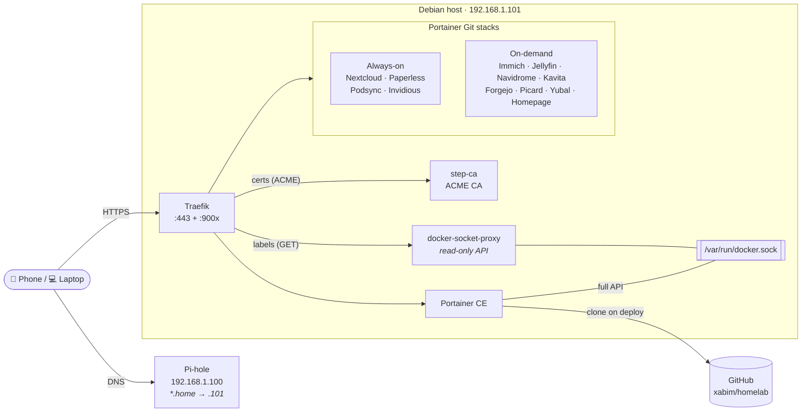
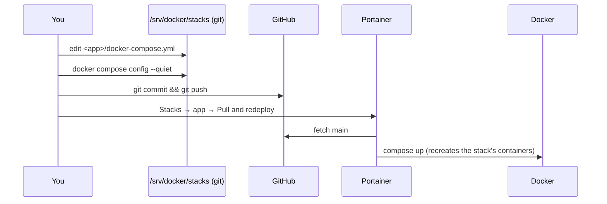

<div align="center">

# 🏠 Homelab

**A small, boring-on-purpose home server.**
Docker Compose stacks, managed from a phone with Portainer, deployed from Git,
with real TLS on every service and resource limits on every container.

`Debian 13` · `Docker + Compose` · `Portainer CE` · `Traefik v3` · `step-ca` · `ZFS mirror`

</div>

---

> **Design goal:** a single app failure must never take down the host —
> and turning an app on or off should take one tap.

## ✨ At a glance

| | |
|---|---|
| 🖥️ **Host** | Intel i5-12400 · 16 GB RAM · NVMe (OS, configs, databases) · ZFS mirror 2×4 TB (`tank/data` → `/srv/data`) |
| 📦 **Stacks** | 12 app stacks managed by **Portainer** (from this repo on GitHub) + 4 infrastructure stacks managed by CLI |
| 🔐 **TLS** | Internal CA (**step-ca**) issues certificates to **Traefik** over ACME — every `*.home` URL is real HTTPS |
| 🌐 **DNS** | **Pi-hole** on a separate device (`192.168.1.100`) resolves `*.home` → `192.168.1.101` |
| 📱 **Ops** | Start/stop/logs/restart from a phone at `https://portainer.home` |
| 📖 **Runbooks** | Everything operational lives in [`playbooks/`](playbooks/README.md) |

---

## 🧭 Architecture



**Two kinds of stacks, on purpose:**

| Layer | Stacks | Managed by | Why |
|---|---|---|---|
| **Infrastructure** | `traefik`, `step-ca`, `docker-socket-proxy`, `portainer` | `docker compose` (CLI, from this directory) | Routing and TLS must never depend on Portainer or GitHub being reachable. Portainer must not manage itself. |
| **Applications** | everything else | **Portainer Git stacks** (`main` branch, auto-update **off**) | One-tap start/stop from a phone; Git is the single source of truth. |

---

## 📋 Service catalog

| Service | URL | Mode | Stack | Direct IP fallback |
|---|---|---|---|---|
| 🎬 Jellyfin | https://jellyfin.home | on-demand | `jellyfin` | `:9002` |
| 🎵 Navidrome | https://music.home | on-demand | `navidrome` | — |
| 📺 Invidious | https://invidious.home | always-on | `invidious` | `:9005` |
| 🎙️ Podsync | https://podsync.home | always-on | `podsync` | `:9010` |
| ☁️ Nextcloud + ONLYOFFICE | https://cloud.home · https://office.home | always-on | `nextcloud` | — (hard-redirects to its domain) |
| 📸 Immich | https://immich.home | on-demand | `immich` | `:9008` |
| 📄 Paperless-ngx | https://paperless.home | always-on | `paperless` | `:9006` |
| 📚 Kavita | https://books.home | on-demand | `kavita` | — |
| 🦊 Forgejo | https://forgejo.home | on-demand | `forgejo` | — |
| 🏷️ MusicBrainz Picard | https://picard.home | on-demand | `musicbrainz-picard` | — |
| 🎧 Yubal | https://yubal.home | on-demand | `yubal` | — |
| 🧭 Homepage | https://homepage.home | on-demand | `homepage` | `:9003` |
| 🐳 Portainer | https://portainer.home | infra | `portainer` (CLI) | `:9001` |
| 🚦 Traefik dashboard | — (no DNS record) | infra | `traefik` (CLI) | `:9004` |
| 🔏 step-ca | https://ca.home:9000 | infra | `step-ca` (CLI) | `:9000` |
| 🛡️ Pi-hole | https://192.168.1.100/admin | external | — (other device) | — |

> Every app compose file starts with a header (purpose, mode, URL, data, notes) —
> visible in Portainer under **Stacks → *app* → Editor**.

---

## 🔁 How a change reaches production



* **Start / Stop** use Portainer's local clone — they work even if GitHub is down.
* **Stop** = `compose down`: containers and project networks are removed, bind-mounted data is untouched.
  A stopped stack therefore **stays off after a reboot**.
* **Pull and redeploy** recreates **all** containers of the stack, not just the changed ones.

👉 Step by step: [`playbooks/02-deploy-a-change.md`](playbooks/02-deploy-a-change.md)

---

## 📂 Repository layout

```text
/srv/docker/stacks/                 ← this repo (github.com/xabim/homelab)
├── README.md
├── playbooks/                      ← operational runbooks
├── .env.global                     ← TZ, PUID/PGID, base paths (shared by all stacks)
├── resource-limits.yaml            ← reference copy of the resource anchors
├── docker-compose.{traefik,db,socket}.yml   ← snippet templates for new services
├── prompt.md                       ← AI-assistant prompt for adding services
└── <stack>/
    ├── docker-compose.yml          ← the stack (header comment explains it)
    ├── .env                        ← non-secret variables (tracked — repo is public!)
    └── .env.secrets                ← secrets, mode 600, gitignored

/srv/docker/volumes/<app>/          ← configs + databases (NVMe, not in Git)
/srv/data/<app>/                    ← bulk data: media, photos, files (ZFS mirror)
```

> ⚠️ **The GitHub repo is public.** `.env` files and compose files are world-readable;
> anything secret goes in `.env.secrets` (gitignored) — never anywhere else.

---

## 🔐 Secrets

* Every stack references its secrets by **absolute path**:
  `- /srv/docker/stacks/<app>/.env.secrets`
* Portainer has `/srv/docker/stacks` mounted **read-only at the same path**, so Git stacks
  (which run from a clone without gitignored files) can still read them.
* **Exception — Invidious:** its secrets are interpolated into `INVIDIOUS_CONFIG`, so they are
  **Portainer stack variables** (`POSTGRES_PASSWORD`, `SERVER_SECRET_KEY`, `HMAC_KEY`).

👉 [`playbooks/07-secrets.md`](playbooks/07-secrets.md)

---

## 🌐 Networking, DNS & TLS

```text
 client ──DNS──► Pi-hole (192.168.1.100): *.home → 192.168.1.101
 client ──443──► Traefik ──(Host rule from container labels)──► app container
                    │
                    └── certificates via ACME from step-ca (ca.home:9000)
```

* **Networks:** `proxy` (Traefik ↔ apps) and `dockersock` (socket proxy) are **external** —
  created once by hand, never touched by stack operations. Each multi-container app also gets
  its own private network (`immich_immich`, `nextcloud_internal`, `paperless_default`, …).
* **Routing:** declared per service with Traefik labels — ``Host(`app.home`)``, `websecure`,
  `certresolver=stepca`.
* **Trusting the CA:** containers that call other `*.home` services mount
  `/srv/docker/volumes/step-ca/certs/root_ca.crt` (or use `NODE_EXTRA_CA_CERTS` for Node apps).
* **Port fallback:** Traefik publishes `:9001`–`:9006`, `:9008` and `:9010` for access by IP when DNS is down
  (routers in `/srv/docker/volumes/traefik/dynamic/port-routing.yml`).
* **New hostname?** Add it to Pi-hole — Traefik and step-ca do the rest.

### Docker API access

| Consumer | Access | Via |
|---|---|---|
| Traefik, Homepage | read-only (`GET`) | `tcp://docker-socket-proxy:2375` on `dockersock` |
| Portainer | full (deploy, start/stop, exec) | `/var/run/docker.sock` mounted directly |

Portainer is the **only** application allowed to mount the socket: it needs write access, and a
write-enabled proxy would be equally powerful while exposing more to the other proxy clients.

---

## 📐 Resource limits & OOM policy

Every service has hard limits. Compose can't share YAML anchors across files, so each
`docker-compose.yml` copies the anchors it needs from [`resource-limits.yaml`](resource-limits.yaml).

| Tier | Memory limit | Reservation | CPUs | PIDs |
|---|---:|---:|---:|---:|
| `xsmall` | 128 MB | 32 MB | 0.25 | 128 |
| `small` | 256 MB | 64 MB | 0.5 | 256 |
| `medium` | 512 MB | 128 MB | 1.0 | 512 |
| `large` | 1 GB | 256 MB | 2.0 | 1024 |
| `xlarge` | 2 GB | 512 MB | 4.0 | 2048 |

| Role | `oom_score_adj` | Stop grace | Used for |
|---|---:|---:|---|
| `core` | −400 | 60 s | Traefik, step-ca, socket proxy |
| `cache` | −200 | 20 s | Redis |
| `db` | −100 | 60 s | PostgreSQL |
| `service` | +200 | 30 s | web apps |
| `worker` | +300 | 45 s | background workers |
| `batch` | +500 | 120 s | long batch jobs |

```yaml
services:
  myapp:
    <<: [*resource_medium, *resource_service]
```

Under memory pressure the kernel sacrifices apps first and keeps routing, TLS and databases alive.
A 15.7 GB swap partition gives it room to breathe before that.

**Forbidden:** `deploy.resources` (Swarm-only, silently ignored) · containers without limits ·
mounting the Docker socket in apps (Portainer excepted) · anonymous volumes for data that matters.

---

## 🛡️ Container hardening

```yaml
security_opt: [no-new-privileges:true]
cap_drop: [ALL]
cap_add: [<only what the image needs>]
read_only: true          # where the image allows it, with tmpfs for /tmp and /run
```

When an image can't cope with `cap_drop: ALL` (Forgejo, Picard, Portainer), the compose file says
so in a comment.

---

## 💾 Storage & data safety

| Where | What | Protected by |
|---|---|---|
| `/srv/data` (ZFS mirror `tank/data`) | media, photos, Nextcloud files, books, documents, Git repos | mirror redundancy + monthly scrub (`zfsutils-linux`) |
| `/srv/docker/volumes` (NVMe) | configs + **all PostgreSQL databases** | ⚠️ manual backups only — see playbook |
| `/srv/docker/stacks` | compose files | Git + GitHub |

**Rules that keep data safe across stop/start:**

* Everything persistent is an **absolute bind mount** — no named volumes, no anonymous volumes
  holding data (image-declared `VOLUME`s get an explicit bind, e.g. ONLYOFFICE).
* Never `docker compose down -v`, never `docker volume prune` without looking first.

👉 [`playbooks/04-backup-and-restore.md`](playbooks/04-backup-and-restore.md)

---

## ➕ Adding a service — checklist

- [ ] `<app>/docker-compose.yml` starting with the standard header comment
- [ ] Resource anchors (size tier + role) copied in
- [ ] Data in `/srv/docker/volumes/<app>` (config/DB) or `/srv/data/<app>` (bulk) — absolute bind mounts
- [ ] Secrets in `<app>/.env.secrets` (mode 600), referenced by absolute path
- [ ] Traefik labels with `certresolver=stepca` and `<app>.home`
- [ ] Pi-hole DNS record `<app>.home → 192.168.1.101`
- [ ] `security_opt: no-new-privileges`, `cap_drop: ALL` (or a comment saying why not)
- [ ] Healthcheck, `restart: unless-stopped`, no unnecessary published ports
- [ ] Deployed as a Portainer Git stack; tile added to Homepage

👉 [`playbooks/05-add-a-new-service.md`](playbooks/05-add-a-new-service.md) · templates:
[`docker-compose.traefik.yml`](docker-compose.traefik.yml),
[`docker-compose.db.yml`](docker-compose.db.yml),
[`docker-compose.socket.yml`](docker-compose.socket.yml)

---

## 📖 Playbooks

| # | Playbook | Use it when… |
|---|---|---|
| 01 | [Start & stop apps](playbooks/01-start-stop-apps.md) | you want to use an on-demand app |
| 02 | [Deploy a change](playbooks/02-deploy-a-change.md) | you edited a compose file |
| 03 | [Update images](playbooks/03-update-images.md) | an app has a new version |
| 04 | [Backup & restore](playbooks/04-backup-and-restore.md) | before risky changes, or something broke |
| 05 | [Add a new service](playbooks/05-add-a-new-service.md) | you want a new app |
| 06 | [Infrastructure stacks](playbooks/06-infrastructure-stacks.md) | touching Traefik, step-ca, socket proxy or Portainer |
| 07 | [Secrets](playbooks/07-secrets.md) | adding or rotating a secret |
| 08 | [Reboot, shutdown & power](playbooks/08-reboot-and-power.md) | restarting the host |
| 09 | [Troubleshooting](playbooks/09-troubleshooting.md) | something doesn't load |
| 10 | [Disaster recovery](playbooks/10-disaster-recovery.md) | Portainer, Git or the host is gone |
| 11 | [Health check](playbooks/11-health-check.md) | monthly once-over |

---

<div align="center">

**Stable. Predictable. Boring.** That's the point. 🧱

</div>
