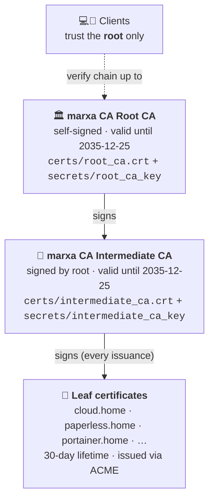
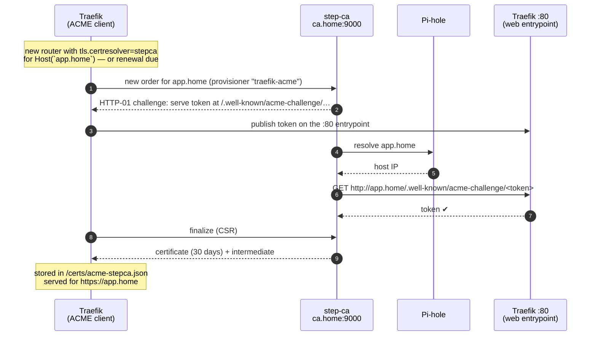

# 🔐 TLS & internal PKI — how it works

Every `https://*.home` URL in this homelab serves a **real certificate from a private Certificate
Authority** that runs on the same host. No self-signed certificates, no browser warnings (once the
root is trusted), and no manual renewals — Traefik obtains and renews everything over **ACME**,
the same protocol Let's Encrypt uses, but against our own CA: **step-ca**.

> 🛠️ Hands-on tasks (trust a device, inspect, force-renew, add a hostname, fix errors, back up the CA)
> live in [`playbooks/12-tls-certificates.md`](../playbooks/12-tls-certificates.md).

---

## 1. The pieces

| Component | Where | Role |
|---|---|---|
| **step-ca** (`smallstep/step-ca`) | stack `step-ca`, data in `/srv/docker/volumes/step-ca` | The Certificate Authority. Holds the root + intermediate keys, exposes an ACME server at `https://ca.home:9000` |
| **Traefik v3** | stack `traefik`, config in `/srv/docker/volumes/traefik` | Reverse proxy. ACME **client**: requests, stores and renews a certificate per hostname, terminates TLS |
| **Pi-hole** | separate device on the LAN | DNS. Resolves `*.home` → the host's IP for clients **and for step-ca itself** during validation |
| **Root certificate** `root_ca.crt` | `/srv/docker/volumes/step-ca/certs/` | The public anchor every client must trust |

---

## 2. Chain of trust



* The **root** signs only the intermediate. Its key is needed again only if the intermediate must be
  re-issued.
* The **intermediate** signs every leaf certificate. Its key is used daily by step-ca, unlocked with
  `secrets/password`.
* Clients trust **only the root**. Traefik sends `leaf + intermediate` in the TLS handshake, so the
  chain verifies.

Root fingerprint (SHA-256) — use it to verify the file you install on a device:

```text
C2:78:1A:B3:59:3C:4F:0F:13:80:94:05:54:F3:EE:7C:7B:20:7F:5A:AF:E5:FD:31:02:5E:F7:75:00:6A:11:CB
```

---

## 3. How a certificate is issued (ACME HTTP-01)



Key consequences:

1. **The hostname must resolve in Pi-hole before it can get a certificate.** step-ca uses Docker's
   embedded DNS (`127.0.0.11`), which forwards to the daemon's DNS server (Pi-hole).
2. **Port 80 must reach Traefik** — that's the validation path. The `web` entrypoint otherwise
   redirects everything to HTTPS (the ACME challenge route is served before the redirect).
3. **Traefik reaches step-ca by name** `ca.home`: step-ca carries the network alias `ca.home` on the
   `proxy` network, so this lookup never leaves Docker.
4. **Traefik must trust step-ca's own TLS** (the ACME directory is HTTPS): the root is mounted into
   Traefik and pointed to with `LEGO_CA_CERTIFICATES` (`traefik/.env`).

---

## 4. Configuration, piece by piece

### step-ca — `/srv/docker/volumes/step-ca/config/ca.json`

| Setting | Value |
|---|---|
| Listen address / DNS name | `:9000` · `ca.home` (also published on the host as `:9000`) |
| Database | BadgerDB in `db/` (issued-certificate records) |
| Provisioner `traefik-acme` | type **ACME**, default/max TLS cert duration **720 h (30 days)**, renewal allowed |
| Provisioner `traefik` | type JWK (not used by Traefik's ACME flow; kept for manual `step` CLI issuance) |
| Minimum TLS | 1.2 |

```text
/srv/docker/volumes/step-ca/
├── certs/root_ca.crt            public — distribute to clients
├── certs/intermediate_ca.crt    public
├── secrets/root_ca_key          🔴 PRIVATE — the whole PKI depends on it
├── secrets/intermediate_ca_key  🔴 PRIVATE
├── secrets/password             🔴 unlocks the keys
├── config/ca.json, defaults.json
└── db/                          issuance database
```

### Traefik — static config `/srv/docker/volumes/traefik/traefik.yml`

```yaml
entryPoints:
  web:
    address: ":80"
    http:
      redirections:
        entryPoint: { to: websecure, scheme: https }
  websecure:
    address: ":443"

certificatesResolvers:
  stepca:
    acme:
      caServer: https://ca.home:9000/acme/traefik-acme/directory
      certificatesDuration: 720             # hours — matches step-ca's 30-day certs
      email: admin@home
      storage: /certs/acme-stepca.json      # → /srv/docker/volumes/traefik/certs/
      httpChallenge:
        entryPoint: web
```

### Traefik — container (`traefik/docker-compose.yml`)

* Mounts the root twice: `/etc/ssl/step/root_ca.crt` and `/usr/local/share/ca-certificates/step-root-ca.crt`.
* Startup command runs `update-ca-certificates` before starting Traefik, so the OS trust store
  includes the root.
* `LEGO_CA_CERTIFICATES=/usr/local/share/ca-certificates/step-root-ca.crt` — Traefik's ACME library
  trusts step-ca's HTTPS endpoint.

### Each service — Docker labels

```yaml
labels:
  - traefik.enable=true
  - traefik.http.routers.<name>.rule=Host(`<app>.home`)
  - traefik.http.routers.<name>.entrypoints=websecure
  - traefik.http.routers.<name>.tls=true
  - traefik.http.routers.<name>.tls.certresolver=stepca     # ← triggers ACME for this host
  - traefik.http.services.<name>.loadbalancer.server.port=<port>
```

The port-fallback entrypoints (`:9001`, `:9002`, …) match any host (`HostRegexp`). Accessed by IP
there is no hostname to pick a certificate for, so Traefik serves its **default self-signed
certificate** — expect a browser warning on `https://<host-ip>:900x`. That's the price of the
DNS-free fallback; use the `*.home` names whenever DNS works.

---

## 5. Who trusts the root

| Where | How |
|---|---|
| Debian host | `/usr/local/share/ca-certificates/step-ca.crt` + `update-ca-certificates` |
| Traefik | mounted root + `update-ca-certificates` at start + `LEGO_CA_CERTIFICATES` |
| Homepage | root mounted at `/usr/local/share/ca-certificates/home-root-ca.crt` (calls `*.home` APIs) |
| Nextcloud | root mounted at `/usr/local/share/ca-certificates/stepca-root.crt` |
| ONLYOFFICE | same file + `NODE_EXTRA_CA_CERTS` (Node.js ignores the OS store) |
| Your devices | installed manually — see the playbook |

---

## 6. Lifecycle & renewal

| Item | Lifetime | Renewed by |
|---|---|---|
| Leaf certificates | 30 days | Traefik, automatically |
| Intermediate CA | until 2035-12-25 | you, with the root key (rare) |
| Root CA | until 2035-12-25 | you — means re-trusting every device (plan ahead) |

Traefik checks renewals at start-up and then periodically. It derives its *renewal window* from
the resolver's `certificatesDuration`, so that value **must match** the lifetime step-ca issues
(`defaultTLSCertDuration` of the `traefik-acme` provisioner, 720 h). Left at Traefik's default
(2160 h = 90 days), every 30-day certificate would always look due and be re-issued on every check.

Traefik only renews certificates it holds in `acme-stepca.json` — including ones for hostnames no
router uses anymore, which fail renewal once their DNS record is gone.
